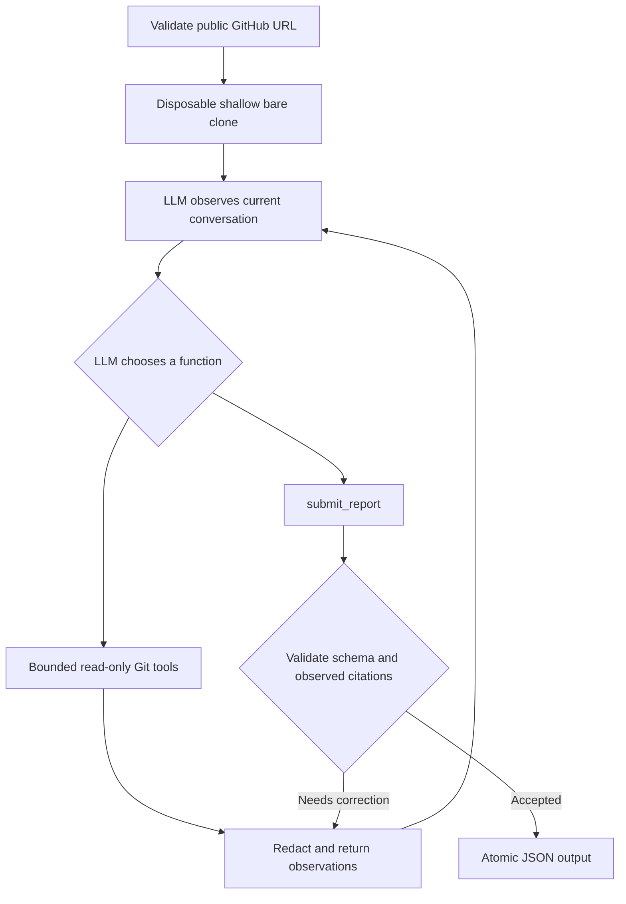

# DevOps Repository Auditing Agent

A Python agent that investigates a public GitHub repository, chooses read-only tools with
Gemini, follows up on observations, and writes an evidence-based JSON report. The reasoning
loop, tool dispatch, budgets, and validation are implemented directly in Python. No LangChain,
LangGraph, n8n, or other agent/orchestration framework is used.

## Requirements

- Python 3.11 or newer and Git on `PATH`.
- Internet access to GitHub and the Gemini Developer API.
- A Gemini API key with access to a function-calling model.

The runtime uses the Python standard library, including `urllib` for Gemini's REST API.
Development tools are optional dependencies. You do not need OpenAI credits.

## Installation and configuration

Clone this repository and enter its directory:

```bash
git clone https://github.com/mehranwazir/-devops-repository-auditing-agent.git
cd ./-devops-repository-auditing-agent
python -m venv .venv
```

Activate the environment on Windows PowerShell:

```powershell
.\.venv\Scripts\Activate.ps1
```

On Linux/macOS:

```bash
source .venv/bin/activate
```

Install the project:

```bash
python -m pip install -r requirements.txt
```

Create a key in [Google AI Studio](https://aistudio.google.com/apikey). Copy `.env.example`
to `.env` (`Copy-Item .env.example .env` in PowerShell; `cp .env.example .env` on Linux/macOS).
Set the local values:

```dotenv
GEMINI_API_KEY=replace_with_your_key
GEMINI_MODEL=gemini-3.5-flash-lite
```

Environment variables take precedence over `.env`. Only these two variable names are loaded.
The program never executes `.env` contents. `.env` is ignored by Git; never commit credentials.
The evaluator supplies their own key; no student key is required or included in the repository.

Google currently lists a free tier for selected Gemini models, including Gemini 3.5 Flash-Lite,
with account-specific quotas. To stay on the free tier, use an eligible project without billing.
This application cannot enforce your Google billing configuration. Check
[current pricing](https://ai.google.dev/gemini-api/docs/pricing) and
[rate limits](https://ai.google.dev/gemini-api/docs/rate-limits) before running.

## Execution

The assignment interface is supported exactly:

```bash
python agent.py --repo https://github.com/OWNER/REPOSITORY --output report.json
```

A concrete public repository example:

```bash
python agent.py --repo https://github.com/pallets/click --output report.json --trace trace.jsonl
```

The CLI runs unattended. Success returns exit code `0` and writes the report atomically.
Fatal input, clone, provider, budget, and file errors return nonzero with a message on stderr.
A failed audit does not overwrite a previous report; check the exit code before treating a
pre-existing file as a new result. No synthetic clean report is written on fatal failure.

| Option | Purpose | Default |
| --- | --- | --- |
| `--repo` | Public `https://github.com/OWNER/REPO` URL | Required |
| `--output` | JSON destination; parent directory must exist | Required |
| `--trace` | Redacted JSONL observations and tool calls | Disabled |
| `--model` | Override `GEMINI_MODEL` | `gemini-3.5-flash-lite` |
| `--max-turns` | Maximum model requests, from 1 to 100 | 28 |
| `--max-calls` | Maximum total function calls, from 1 to 100 | 90 |

The installed `devops-audit` command accepts the same options.

## Architecture and agent behavior



The model decides which tools to call and which files to investigate. There is no deterministic
scanner that manufactures a checklist of violations. For example, after reading `run: make test`
in CI, the model can read `Makefile` and discover whether the invoked command masks failures.
Tool outputs and errors are added to the conversation so the next model request can interpret
them and choose follow-up tools. `submit_report` is also model-selected.

The host requires successful file discovery, commit-history inspection, and a source/configuration
read before accepting a report for a nonempty repository. File citations must reference paths
and lines actually observed through tools. Repository-wide absence findings require complete
file-list pagination. These checks validate provenance, not the semantic truth of a claim;
the model still needs to interpret context correctly. Duplicate rule/file/line findings collapse.

| File | Responsibility |
| --- | --- |
| `agent.py` | CLI, local configuration, lifecycle, and exit codes |
| `tools.py` | `list_files`, `read_file`, `search_code`, `git_log`, tool schemas |
| `auditor/loop.py` | Explicit model/tool loop, budgets, tool errors, traces |
| `auditor/provider.py` | Gemini REST adapter, bounded retries, content/signature preservation |
| `auditor/repository.py` | URL validation, isolated Git configuration, disposable bare clone |
| `auditor/prompts.py` | Investigation guidance, severity policy, false-positive controls |
| `auditor/redaction.py` | Filter known credentials and common secret patterns |
| `auditor/report.py` | Contract validation, deduplication, atomic output |
| `tests/` | Offline tool, agent, CLI, and provider tests |

## Inspection scope and evidence policy

The model investigates repository hygiene, dependencies, code quality, tests, CI, security,
configuration, collaboration, and build/release practices as relevant to the repository.
It follows CI commands into scripts and considers equivalent implementations before reporting
missing practices. A library without a lockfile or a project without a particular optional
linter is not automatically defective. Review instructions can live in the README.

No claims are made about remote branch protection or review enforcement from local files.
Tests and linters in the target are not run: missing CI test execution can be evidenced from
configuration, but a claim that tests fail cannot. ML training, datasets, model evaluation,
and experiment tracking are outside the audit scope.

Severity guidance: `critical` for exposed usable credentials or privileged untrusted-code
execution; `high` for concrete serious security/release bypasses; `medium` for meaningful
reliability, testing, or configuration defects; `low` for minor evidenced hygiene problems.
Context matters. Fixtures, examples, placeholders, and intentional teaching samples should
not be confused with deployed vulnerabilities.

## Output contract

The top level contains exactly `repository` and `violations`. Every finding contains:

| Field | Meaning |
| --- | --- |
| `rule_id` | Stable code such as `CI-001` or `SEC-001` |
| `category` | DevOps area, such as `ci`, `security`, or `testing` |
| `severity` | `critical`, `high`, `medium`, or `low` |
| `file` | Repository-relative tracked file, or JSON `null` when inapplicable |
| `line` | Observed 1-based source line, or JSON `null` when inapplicable |
| `description` | Defect and its impact |
| `evidence` | Concrete observed fact and explanation; secrets are redacted |
| `recommendation` | Actionable remediation |

An empty `violations` array is a successful valid result when no defensible defect is found.
Line numbers refer to the default-branch commit recorded in the trace, not later revisions.

## Safety and limitations

- Targets are fetched into a disposable bare repository, without checkout. Files are inspected
  by blob object ID. No hooks, filters, submodules, target tests, package installation, or target
  scripts execute. Symlinks and submodules are listed but not followed. No writes reach targets.
- Only public GitHub HTTPS repository URLs are accepted; credentials, query strings, other hosts,
  and local paths are rejected. Git credentials/global configuration are disabled for inspection.
- Source, commit messages, and filenames are untrusted data. The system prompt tells the model
  to ignore repository instructions. Tools have no shell or target-execution capability.
- Common token formats, private keys, credential assignments, and the supplied API key are
  redacted before tool output reaches the model or trace. Redaction is best effort; unfamiliar
  secret formats can evade patterns. Only audit public repositories you are permitted to inspect.
- The model receives repository content via Google's API. Free-tier data handling follows
  [Google's terms and pricing disclosures](https://ai.google.dev/gemini-api/docs/pricing).
- The clone includes up to 50 recent commits from one branch, without tags. `git_log` reads
  metadata, not every historical blob. This is not a full historical secret scanner.
- Limits: 20,000 tracked entries, 256,000 bytes per text blob, 300 lines/24,000 characters per
  read page, 100 files per search page, 600,000 serialized conversation characters. File listing,
  reads, and search expose cursors; truncated/unsupported files must not be treated as clean.
- Git operations have timeouts (90 seconds for clone, 30 for reads); API requests have a
  120-second socket timeout and at most two short retries for transient errors. There is no hard
  clone disk/network quota or OS-level memory sandbox. Very large or adversarial repositories
  should be audited within an externally resource-limited container/VM.
- Model findings are nondeterministic. Observed-line validation does not prove semantic accuracy,
  recall, or complete coverage. Unavailable checks are recorded in the trace, not fabricated.
  A successful report can reflect limited coverage; inspect traces when evaluating completeness.

## Tests and CI

Install development tools and run checks:

```bash
python -m pip install ".[dev]"
python -m pytest
python -m ruff check .
python -m ruff format --check .
python -m build
```

Tests use disposable local Git repositories and scripted **test-only** provider responses.
They require no API key, make no model calls, and do not execute fixture source code. Coverage
includes pagination, literal search, target immutability, path/symlink safety, file limits,
secret redaction, dynamic follow-up selection, healthy output, error recovery, provenance,
deduplication, provider request shape, invalid inputs, and missing credentials.
These tests verify implementation behavior; they are not hidden-repository precision/recall scores.

GitHub Actions runs tests, lint/format checks, and package-build validation on pushes and pull
requests with read-only repository permissions and no API secret requirement.

Local validation on Python 3.13.3 passed all 53 tests, Ruff lint and formatting checks, and
both source-distribution and wheel builds. The live sample audit below also completed with
the real Gemini API; the offline test count does not include that separate run.

For contributions, use a branch and pull request, describe behavior changes, and run the checks
above. Review safety boundaries and false-positive risks. Never add real credentials to fixtures.

## Sample audit and reproducibility

[`sample_report.json`](sample_report.json) is authentic output from a live audit of
[`pallets/markupsafe`](https://github.com/pallets/markupsafe), using Gemini 3.5 Flash-Lite.
[`sample_trace.jsonl`](sample_trace.jsonl) records the observations and model-selected calls.

| Run detail | Recorded value |
| --- | --- |
| Date | October 16, 2026, 04:25 Asia/Karachi (trace uses UTC) |
| Inspected commit | `4e111271b1494995708a9e878a10829b5e10c7ba` |
| Model turns / function calls | 6 / 11 |
| Violations | 0 |

The model discovered the file tree and commit history, read `pyproject.toml`, investigated test,
publish, lock, pre-commit, and security-analysis workflows, and followed up by reading pre-commit
configuration before submitting an empty report. This is a mostly healthy repository example,
not proof that every possible defect is absent. No hidden-repository performance is claimed.

Regenerate the sample with your own key:

```bash
python agent.py --repo https://github.com/pallets/markupsafe --output sample_report.json --trace sample_trace.jsonl
```

To reproduce an audit, run the command with `--trace`, compare the commit in the first trace
event, and retain both files. Repository changes, provider/model updates, and nondeterminism
can change findings. Never interpret unavailable checks or fixture tests as a completed live audit.

## Troubleshooting

| Error | Resolution |
| --- | --- |
| Missing `GEMINI_API_KEY` | Set it in the invocation directory's `.env` or environment |
| HTTP 401/403 | Check the key, API restrictions, account/region and project access |
| HTTP 404 | Select a model available to your key using `--model` or `GEMINI_MODEL` |
| HTTP 429 | Wait for quota reset; check free-tier limits; avoid repeated concurrent audits |
| Git operation failed | Confirm the URL is public, Git is installed, and GitHub is reachable |
| Budget exhausted | Increase `--max-turns`/`--max-calls` within the documented maximum |
| Cannot read/write files | Confirm the destination directory exists and permissions allow writes |

## Submission

Submit **only the public GitHub repository URL** through the course submission channel.
All installation, configuration, architecture, execution, validation, and related information
is included in this README. The executable code, tests, `.env.example`, and authentic sample
output belong in the repository; the assignment PDF and local credentials are excluded.

## References

- [Gemini function calling](https://ai.google.dev/gemini-api/docs/function-calling)
- [Gemini pricing](https://ai.google.dev/gemini-api/docs/pricing)
- [Git plumbing and object storage](https://git-scm.com/book/en/v2/Git-Internals-Plumbing-and-Porcelain)
